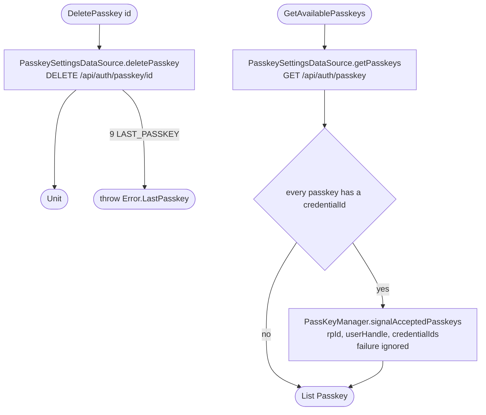

[← Operations](../README.md)

# Delete passkey / Get available passkeys

`DeletePasskey(id)` → `DELETE /api/auth/passkey/{id}` · `GetAvailablePasskeys()` → `GET /api/auth/passkey`
· both called from `PasskeyViewModel`. `GetAvailablePasskeys` is also called by [Create new passkey](create-new-passkey.md).

Network only, with no cache. Error 9 maps to `LastPasskey`; other failures propagate.

`GET /api/auth/passkey` answers a `PasskeyList`: the relying party id (`rpId`, 1), the account's base64url
`userHandle` (2) and the passkeys (3), each with its base64url `credentialId` (6). `GetAvailablePasskeys` tells the
device's passkey provider which passkeys the account still accepts (`PassKeyManager.signalAcceptedPasskeys` →
`reportAcceptedCredentials`: Android `SignalAllAcceptedCredentialIdsRequest`, iOS 26
`reportAllAcceptedPublicKeyCredentials`), so a passkey deleted here or elsewhere stops being offered. It skips the
signal when any passkey has no credential id, since that list would make the device drop a passkey that still
works, and ignores a failed signal. `PasskeyViewModel` reloads the list after every add and delete, so each change is
signalled. On the mobile apps the use case is also a `BackgroundDataFetchAction`, which signals once after sign-in
and on later background fetches; the client web app binds it without that trigger (no passkeys on the web).

