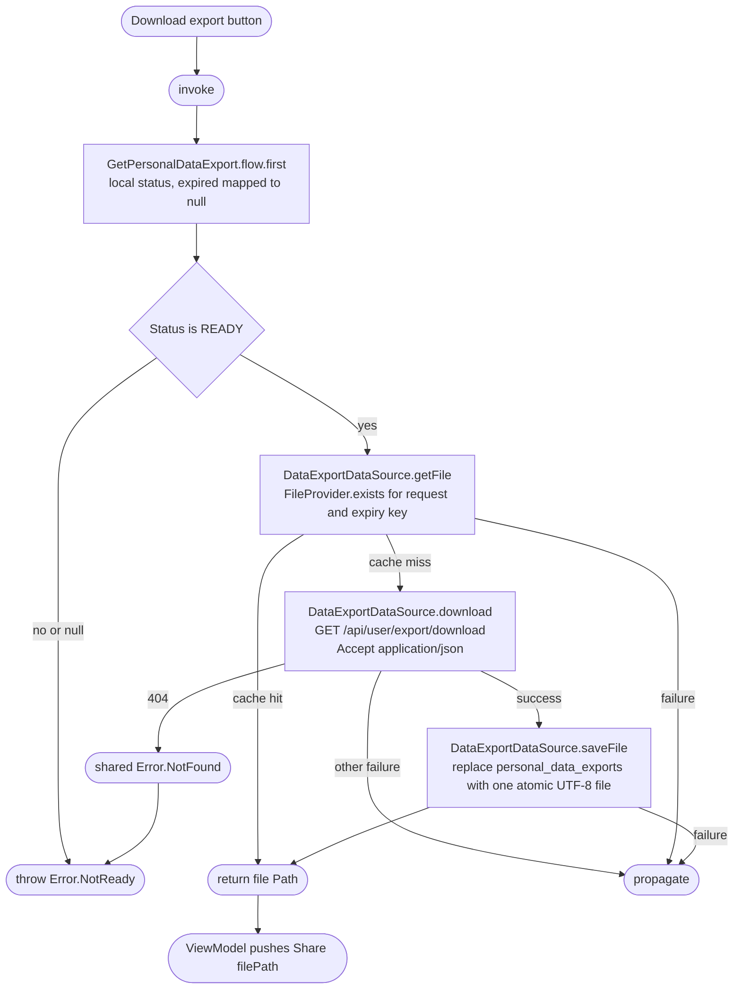

[← Operations](../README.md)

# Download personal data export

`DownloadPersonalDataExport` returns the path of the cached JSON file for the current READY export,
downloading and storing it first when no matching file exists. The ViewModel delegates each Download
press to this use case and pushes `PersonalDataExportDestinations.Share(filePath)`; each platform opens
its native share sheet for that file at the navigation edge.

JSON is stored unchanged; no export schema leaks into domain. The file lives at
`personal_data_exports/<requestedAt>-<expiresAt>/bookk-personal-data.json` in the app cache (epoch
milliseconds), so a new request or expiry misses the old file and the share sheet always offers the
same file name. `saveFile()` clears the directory before writing, so at most one export is kept.
Refreshes that return a non-downloadable status, new export requests and logout remove the
directory. The OS may evict cache files; a missing file triggers another download. There is no Room
payload column or preferences bucket.

A successful download is saved before sharing, so sharing cancellation can retry without another
backend download. Failed network calls never populate the file cache; atomic replacement prevents
partial writes from becoming cache hits. `FileProvider` owns existence checks, atomic UTF-8 writes and
recursive deletion through a shared `CommonFileProvider` implementation inherited by Android and iOS
providers.

The share sheet opens the cached file directly, without copying it. Android resolves the path through
the settings presentation module's non-exported `FileProvider` (authority
`<applicationId>.personal_data_exports`, exposing only `cache/personal_data_exports/`) and starts an
`ACTION_SEND` chooser with MIME type `application/json` and a read-only grant. iOS presents
`UIActivityViewController` in a sheet with the file URL, including Save to Files. Files explicitly saved
or shared outside Bookk remain under the user's control.

`NotReady` hides stale download and request actions and asks the user to refresh status. Other
failures are shown once inline and leave download available for retry. Authentication/access
failures use shared notifications. Downloading or opening native sharing plays no success haptic.
The existing operation launch key excludes overlapping screen actions. JSON content never enters UI
state or navigation; only the file path does.
