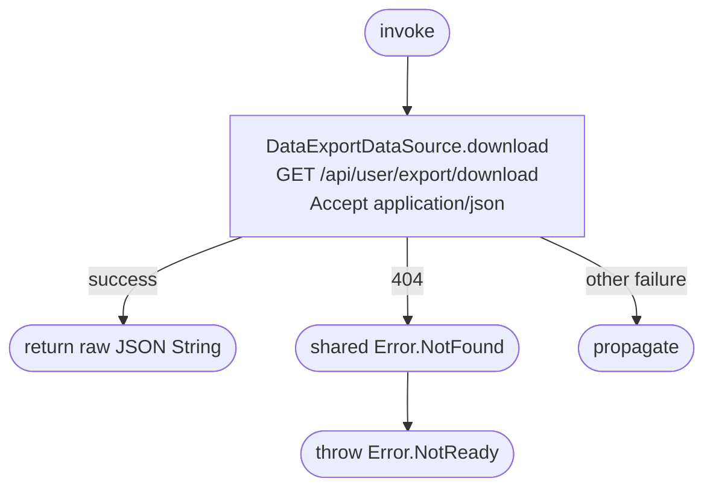

[← Operations](../README.md)

# Download personal data export

`DownloadPersonalDataExport` → `GET /api/user/export/download`. No local persistence.

Returns the downloaded JSON unchanged; no export schema leaks into domain, no local file is created,
and no download data is cached. The caller owns subsequent saving/sharing. The backend permits repeat
downloads until expiry. For a business, 404 may also mean the caller is not the owner. Authentication
remains required; downloading does not prompt for another passkey.

The shared HTTP mapper classifies an unstructured 404 as `me.bookk.core.domain.entity.Error.NotFound`.
This use case translates that type to its own `Error.NotReady`, without inspecting HTTP status codes.
