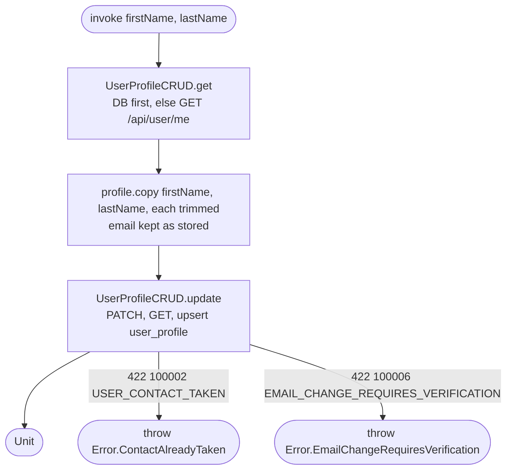

[← Operations](../README.md)

# Edit profile

`EditProfile(firstName, lastName)` → `PATCH /api/user/me`
· called from `EditProfileViewModel`

First and last name are trimmed before they are saved. The email is sent back unchanged from the
stored profile: since backend 0.18.0 a different email is rejected with 100006 and must go through
the email change flow instead ([Start email change](../authorization/start-email-change.md) →
[Confirm email change](../authorization/confirm-email-change.md), opened from Edit Profile's "Change email").

See [User profile CRUD](../authorization/user-profile-crud.md) for the update steps.
