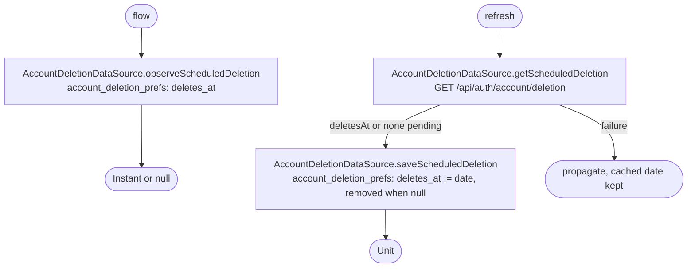

[← Operations](../README.md)

# Get account deletion

`GetAccountDeletion` tells when the account deletion the person requested runs. The backend erases the account
7 days after `DELETE /api/auth/account` (backend #208); until then the account keeps working.
`DeleteAccountViewModel` renders `flow()` and calls `refresh()` when the screen opens, on the mobile apps and in
the Mini App.

[Delete account](delete-account.md) and [Complete Telegram confirmation](complete-telegram-confirmation.md) save
the `deletesAt` the deletion request answers with through the same datasource, so the screen shows the pending
deletion at once. While a date is cached, Delete account shows "Deletion requested. Your account will be deleted
on <date>." (`DateStyle.MEDIUM`, device time zone) and hides the warning, the agreement and the Delete button.
A failed refresh is only logged: the cached date stays on screen. Logout clears the bucket. Cancelling
(`DELETE /api/auth/account/deletion`) is not built yet.
