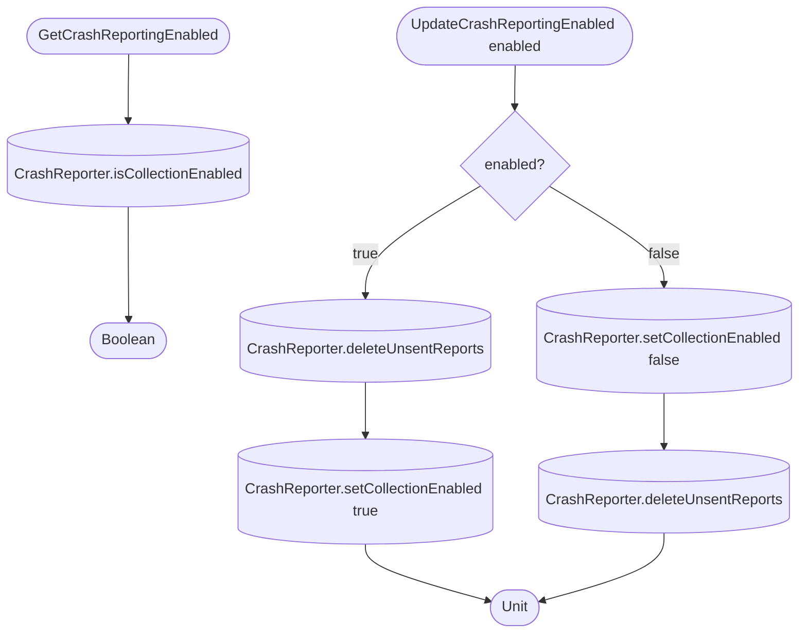

[← Operations](../README.md)

# Get / update crash reporting

`GetCrashReportingEnabled()` and `UpdateCrashReportingEnabled(enabled)`, **local only**. Both are called from
`SettingsDashboardViewModel` (Privacy section, "Send crash reports" switch).

Both go through `library.crashreporting.api.CrashReporter`. The apps implement it with Firebase Crashlytics
(`AndroidCrashReporter` in `androidApp`, `IOSCrashReporter` in `iosApp/iosApp/Library/CrashReporting`) and
provide it through `StateFactoryCreator.createCrashReporter()`, registered as a Koin `single` in `CoreDi`.
Crashlytics stores the choice itself (Android SharedPreferences, iOS `NSUserDefaults`) and reads it at startup
before any app code runs, so the app keeps no copy of its own. The choice is a device preference: it is not
cleared on logout. Collection is on by default, based on legitimate interest (disclosed in the privacy policy).

Changing the choice always deletes unsent reports, so nothing collected around an opt-out is uploaded later.
The order matters: turning off disables collection first, so no new report is queued after the delete;
turning on deletes first, so reports stored while opted out are never sent.

