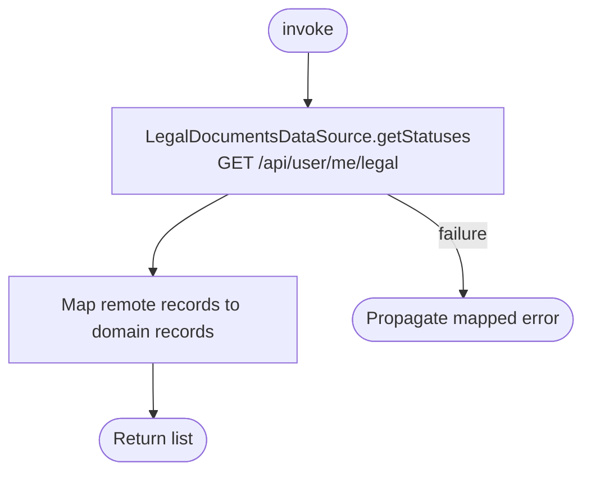

[← Operations](../README.md)

# Get legal document statuses

`GetLegalDocumentStatuses.invoke()` reads the current backend records without persisting them.
There is no local cache or background observer. Empty results are returned unchanged.
Errors propagate through the standard datasource exception mapping; this operation adds no domain errors.

`acceptedAt = null` means the current document has not been accepted. This operation only reads acceptance status. Signup sends accepted document versions through
[Create account](../authorization/create-account.md).

Settings reads this operation when presented and after a successful acceptance or unknown-version
rejection. The Legal section shows current document links and accepted/pending labels on both platforms.
Rows remain visible during a refresh, while consent callbacks are invalidated and acceptance is disabled.
Version identifiers remain bound to the shared records and are not displayed in the compact Settings rows.
A failed read discards old records, blocks acceptance and offers retry; an empty successful read shows
that no documents are published. Published URLs are opened through the shared device facade.
