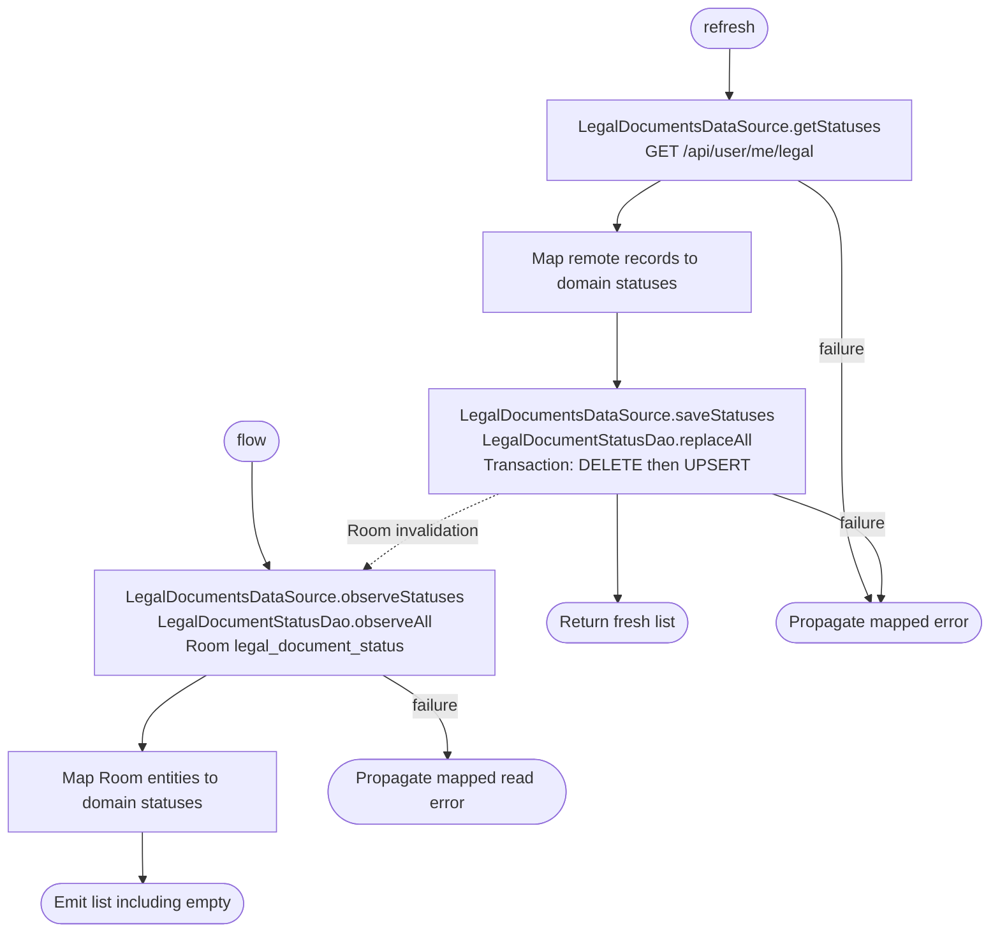

[← Operations](../README.md)

# Get legal document statuses

`GetLegalDocumentStatuses.flow()` observes Room statuses directly without network work. It emits an
empty list when the database has no rows, including before the first refresh and after logout. The
screen treats an unfetched cache and a fetched empty list alike, keeping two unknown-status rows.
`refresh()` fetches current records and replaces the Room snapshot transactionally. There is no sync
marker or preferences dependency. This operation adds no domain errors.

Two ViewModels use it. `PrivacySettingsViewModel` (Settings → Account → Privacy) renders the document rows
and acceptance and refreshes on open with inline retry. `SettingsDashboardViewModel` observes the same flow
only to show "Action required" on the Account → Privacy row while any document is unaccepted, and refreshes
on open; its refresh failures are logged, not shown.

Status records have explicit Room columns for document kind (primary key), version, URL, effective time
and nullable acceptance time. Schema 24 adds the table with `AutoMigration(23, 24)`. The feature data
module owns the entity ↔ domain mapping. `replaceAll()` deletes stale rows and upserts the fresh list in
one transaction, so active observers never see an intermediate empty list. The datasource clears the
table through its singleton `LogOutAction` binding. See [Settings persistence](../../database/settings.md).

`acceptedAt = null` means the current document has not been accepted. This operation only reads acceptance
status. Signup sends accepted document versions through [Create account](../authorization/create-account.md).

Settings subscribes once to the local flow and refreshes when presented, after successful acceptance or an
unknown-version rejection, and on retry. Both platforms always show the Privacy Policy and Terms of
Service rows in that fixed order, starting synchronously before the flow emits. Unknown rows show
“Unknown acceptance status”, have no link callback and hide the external-link arrow. Loaded records
fill the matching row by document type; cached statuses fill the same slots immediately. Missing or
unpublished documents keep their unknown placeholder, so neither a partial response nor an empty
publication removes rows. Supporting another document type requires a new app release.

Refresh and
acceptance use separate `loadLegalDocuments` and `acceptLegalDocuments` keys with
`LaunchBehaviour.DropLatest`, deduplicating each operation independently of UI loading flags.
Acceptance success and unknown-version errors call `loadLegalDocuments()` directly.
Pending cached documents remain available during refreshes and after refresh failures. A failure retains
cached content and offers retry; when both rows are unknown, the section shows its inline load error.
These failures do not also add a notification. Acceptance is visible only for pending documents;
the shared button loading helpers manage its submission state.
After initial placeholder setup, only the local flow updates document rows, callbacks and acceptance labels. Refresh launches manage
loading and error presentation without rendering or storing their return value.
Consent callbacks use the displayed versions; visibility and enabled state determine when they can be triggered.
Version identifiers remain bound to the shared records and are not displayed in the compact Settings rows.
An empty snapshot keeps both unknown rows without a separate empty-publication message.
Clearing the cache restores both unknown rows. Published URLs open through the shared
device facade. Local observation failures use the same inline/retry presentation and retry through the standard observer chain.
