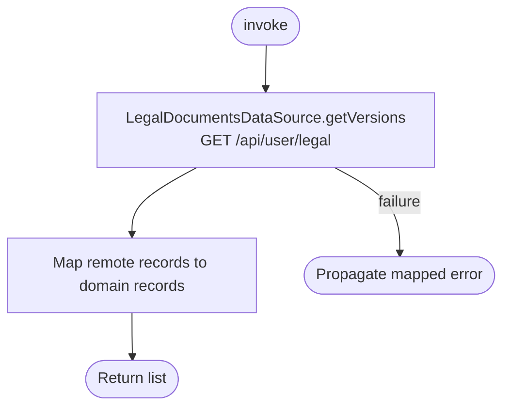

[← Operations](../README.md)

# Get legal document versions

`GetLegalDocumentVersions.invoke()` reads the current backend records without persisting them.
There is no local cache or background observer. Empty results are returned unchanged.
Errors propagate through the standard datasource exception mapping; this operation adds no domain errors.

