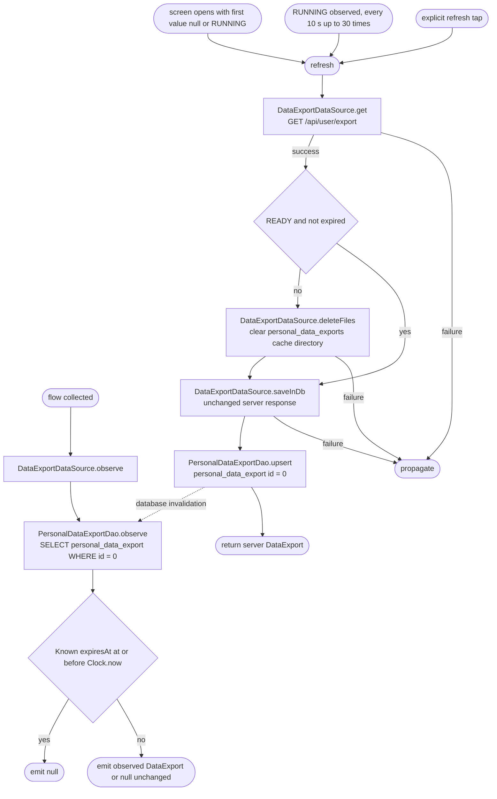

[← Operations](../README.md)

# Get personal data export

`GetPersonalDataExport.flow()` observes the current account's singleton `personal_data_export` row.
It maps an expired record to `null` and emits other values unchanged. Observation is read-only: it
performs no network requests, file cleanup or database writes. The ViewModel invokes `refresh()` when the
screen opens with no usable cache (first observed value is null or RUNNING), every 10 seconds (at most 30 times) while the observed status is RUNNING, and
for explicit refresh actions, using one operation key to exclude overlapping work.

Every cached emission is mapped using the injected clock. A known expiry at or before now emits
`null` for any status; the stored row stays until the next refresh, export request or logout replaces
or clears it. Missing rows also emit `null`. Records with a future or absent expiry are emitted
unchanged. A null observation displays the default request screen.

`refresh()` always fetches `GET /api/user/export` and saves the exact returned status through
`saveInDb()`. When the response is no longer downloadable (any status other than READY, or a known
expiry at or before now), it first removes the personal export files through `deleteFiles()`. A
READY, unexpired response keeps the saved file: files are keyed by request and expiry timestamps, so a
changed export misses the old file and the next download replaces it. A failed network request
preserves local data; cleanup and cache-write failures propagate, and a cleanup failure skips the save.
Database observation remains the source of rendered state; the ViewModel does not render refresh
return values directly.

RUNNING values are emitted unchanged. The ViewModel renders each observed value. Polling is driven by
the RUNNING/not-RUNNING transition (`distinctUntilChanged` + `transformLatest`), not by each emission,
so a refresh that re-saves RUNNING does not trigger another immediate refresh; leaving RUNNING cancels
the timer. Its keyed launch drops requests while a status refresh, export confirmation or download is
active, and request/download are disabled while a status refresh runs.

Only the first observed value decides the opening refresh. A missing or expired record (null) is
unknown local state after logout, reinstall or another device, and RUNNING needs the server to finish;
both trigger one refresh, which also removes an expired export file once the server confirms it.
READY with a future or absent expiry, NONE and FAILED are trusted: their expiry and cooldown are
local timestamps, a missing download yields `NotReady` with a refresh action, and a request blocked
elsewhere yields `TooFrequent`. Opening a valid READY export offline therefore makes no network call.
Later null values never trigger a refresh, so a server response that is already expired cannot loop.
If the app is offline while the opening refresh runs, an expired file stays until the next
successful refresh, export request or logout.

Refresh loading and failures belong to the ViewModel; a failed request leaves the local observation
active and preserves the cached value for retry.

Each datasource method performs one operation: network read, database observation, file cleanup or
database upsert. Cleanup is scoped to `personal_data_exports/`, leaving other export directories
unaffected. Logout clears both this directory and the Room row through the datasource's `LogOutAction`
binding.
