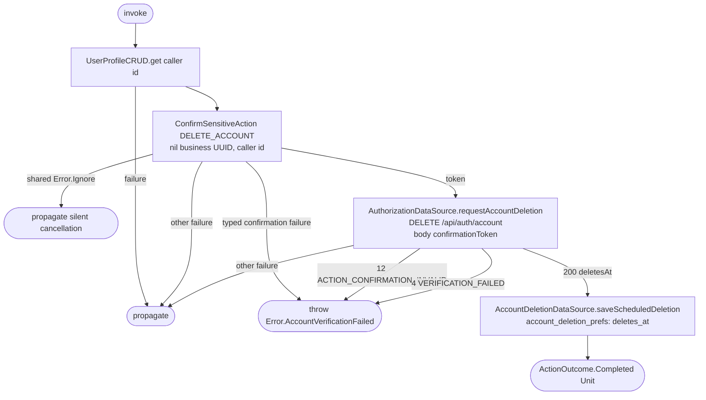
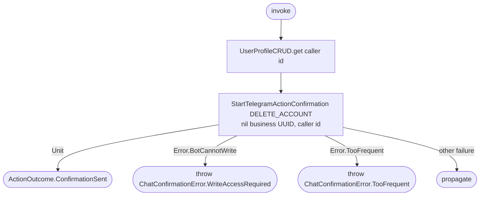

[← Operations](../README.md)

# Request account deletion

`RequestAccountDeletion()` returns an `ActionOutcome<Unit>`. The mobile apps bind `RequestAccountDeletionImpl`, which composes
`UserProfileCRUD.get()` and `ConfirmSensitiveAction` and returns `ActionOutcome.Completed(Unit)`.
`DELETE /api/auth/account` only schedules the deletion: the backend erases the account 7 days later (backend #208), and until then the account keeps working, so the session is kept.
The client web app binds `TelegramRequestAccountDeletionImpl` instead (see [Telegram Mini App](#telegram-mini-app)).
Called from `DeleteAccountViewModel`.

The caller confirms `DELETE_ACCOUNT` with the nil business UUID and their own user UUID as target.
The shared confirmation operation obtains the challenge, prompts for a passkey and exchanges its
assertion at `POST /api/auth/passkey/confirm_action`. Account deletion sends only the resulting
`confirmationToken` to `DELETE /api/auth/account`; the assertion itself is not sent to that endpoint.

The confirmation token is single-use and expires after two minutes. Failed or cancelled confirmation
makes no DELETE request. The passkey stays on the device: the account keeps working during the grace
period and the person may need it to sign in and cancel. The returned `deletesAt` is saved for
[Get account deletion](get-account-deletion.md), which the screen renders. The session, the cache tables and the prefs buckets are never cleared by this operation. The caller profile read can fill its
normal cache on a miss. No automatic retry of confirmation or the protected DELETE is made.
## Telegram Mini App

`TelegramRequestAccountDeletionImpl` only asks for a confirmation in the person's Telegram chat; the account is deleted
later by [Complete Telegram confirmation](complete-telegram-confirmation.md) when they tap Confirm there.

`DeleteAccountViewModel` hands both outcomes to `ChatConfirmationRequest`, shared with Export my data:
`ConfirmationSent` (and `TooFrequent`, a message sent moments ago) shows "We sent a confirmation to your
Telegram chat. Tap Confirm there." and turns the button into "Send again", inactive for a 60-second cooldown;
`WriteAccessRequired` asks Telegram's `requestWriteAccess` (Bot API 6.9) and sends again once if allowed,
otherwise a popup explains that the confirmation needs a message from the bot.

