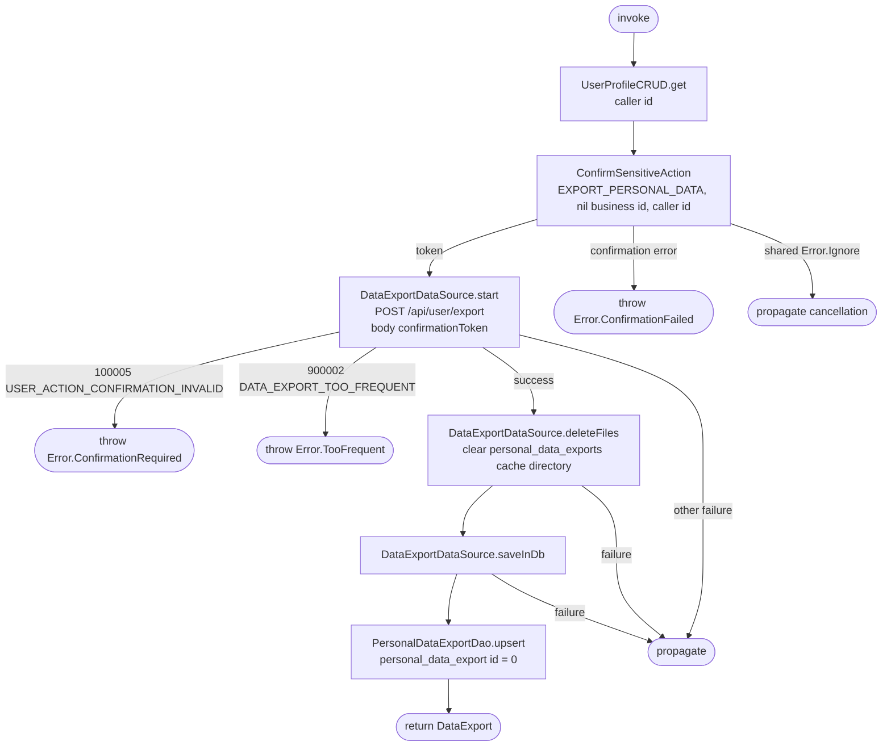

[← Operations](../README.md)

# Start personal data export

`StartPersonalDataExport` → `POST /api/user/export`, then upsert the returned status in Room.

Passkey confirmation is bound to the exact export action and target. The backend builds JSON in the
background and enforces the daily limit; the operation does not poll, save tokens, or retry protected writes.
Use the status operation to inspect progress and cooldown. A confirmation token is single-use and expires
after two minutes. Shared cancellation errors propagate without starting an export.

Settings → Export my data calls this operation only from the request button. A shared presentation
launch key excludes overlapping status reads, confirmations and downloads. Successful requests save
status through a separate datasource call and play one success haptic. The database observer renders
the screen; the start return value is not rendered independently. Confirmation failures appear inline and require another
explicit tap; cancellation is silent. `TooFrequent` hides the request and offers status refresh to obtain
the current availability timestamp. No confirmation token is stored by the presentation layer.

Confirmation and network failures never replace the saved status. Cache write errors propagate.
`CommonDataExportDataSource` is registered as both the datasource and a `LogOutAction`; logout clears
`personal_data_export`. The protected POST remains network-only inside the datasource.

Before saving a successful network status, the use case clears all personal export files through
`DataExportDataSource.deleteFiles()`, even when the READY status and timestamps are unchanged.
Only one personal export can exist at a time. Cleanup is scoped to `personal_data_exports/`, so
other export types can use separate directories without being affected. Failed network requests
preserve the downloaded files. Logout also removes this directory from the app cache. File operations
do not change the Room schema or add preferences. The datasource delegates directory removal to
`FileProvider.deleteRecursively()`; subsequent downloads recreate the directory when saving JSON.
