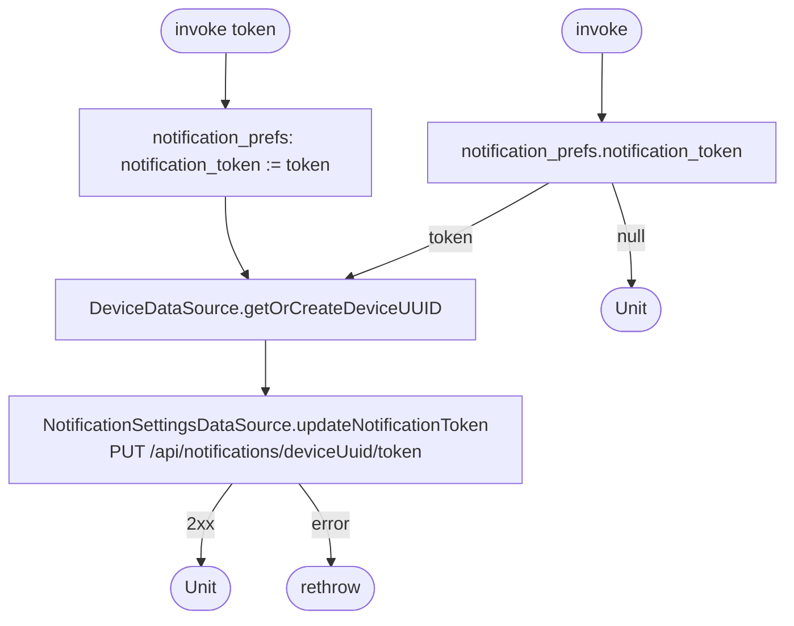

[← Operations](../README.md)

# Update notification token

`UpdateNotificationToken(token)` / `UpdateNotificationToken()` → `PUT /api/notifications/{deviceUuid}/token`
· `invoke(token)` is called from `library/notifications` `TokenBridge.updateInstallationId` when the platform
issues a push token. `invoke()` is called from [background data fetch](../authorization/initial-app-data-fetch.md)
and from `NotificationSettingsViewModel` once push is switched on and the notification permission is granted;
there a failure is only logged.

Every issued token is saved as `notification_prefs.notification_token` before it is uploaded, and logout keeps
it. The backend creates the device row of each login without a token, so the no-argument overload uploads the
stored token again: after a failed upload, after logging in again and when push is switched on.

